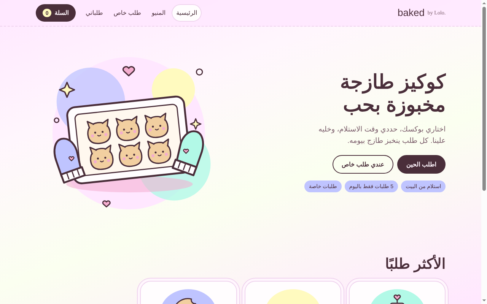

# baked by Lolo. 🍪

متجر إلكتروني لمتجر كوكيز منزلي، فيه رحلة كاملة للزبون ولوحة تحكم لصاحبة المتجر.
المشروع الختامي لبرنامج «رفع الإنتاجية بالذكاء الاصطناعي» في أكاديمية سدايا.

**الاسم:** لينا آل سدران · **المسار:** أداة مبنية

## ملفات المشروع

| الملف | وش فيه |
| --- | --- |
| [`index.html`](index.html) | الموقع كامل في ملف واحد |
| [`capstone.md`](capstone.md) | لوحة المشروع الختامي بأقسامها الثمانية |
| [`PRD.md`](PRD.md) | وثيقة متطلبات المنتج |
| [`SPEC.md`](SPEC.md) | المواصفات التقنية |
| [`AGENTS.md`](AGENTS.md) | تعليمات أي وكيل برمجة يشتغل على المشروع |
| [`screenshot.png`](screenshot.png) | صورة الواجهة |

## المزايا

**للزبون:** الرئيسية والأكثر طلبًا، والمنيو، والسلة، وإتمام الطلب (الاستلام، واليوم، والوقت، وكود خصم)، والدفع بالتحويل، ورسالة واتساب جاهزة، و«طلباتي» لمتابعة الحالة، والتقييم بعد الاستلام، وصفحة طلب خاص.

**لصاحبة المتجر** (تنفتح بحركة سرية: 5 ضغطات سريعة على كلمة baked فوق، ثم اسم مستخدم وكلمة مرور): الأرباح بالشهر، والطلبات وحالاتها، والسلات المتروكة، والزوار، وإدارة المنيو، وحاسبة التكلفة بالجرام، والأكواد، والتقييمات، والطلبات الخاصة، والإعدادات.

## التقنيات

- ملف HTML واحد: HTML و CSS و JavaScript بدون مكتبات
- قاعدة بيانات Claude Artifacts (`db`) مع صلاحيات لكل مسار
- هوية المتجر: Lemon Sorbet ‎#fffabf، Bunny Tail ‎#ffe7ff، Seafair Green ‎#b2f9e7، Changeling ‎#f4adcf، Dried Lilac ‎#bfc4ff

## التشغيل

- **داخل رابط Claude:** كل شي يشتغل: قاعدة البيانات، ولوحة المديرة، والتحليلات
- **برا Claude** (فتح `index.html` مباشرة أو من أي استضافة): المنيو والسلة وإتمام الطلب، والطلب ينرسل بالواتساب. لوحة المديرة والأكواد تحتاج قاعدة البيانات
